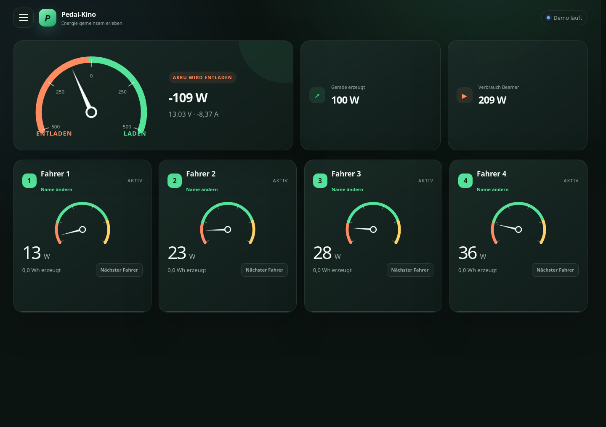
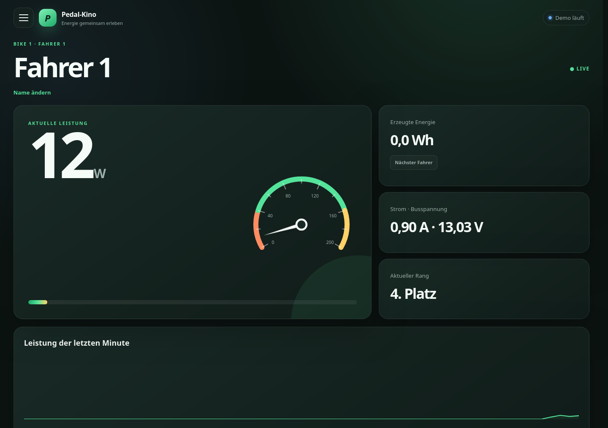
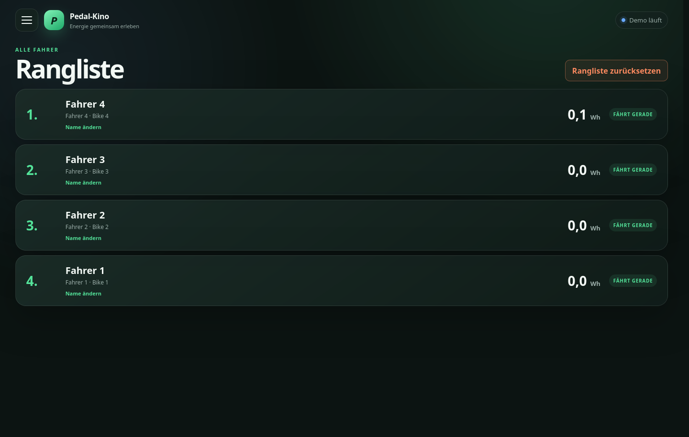
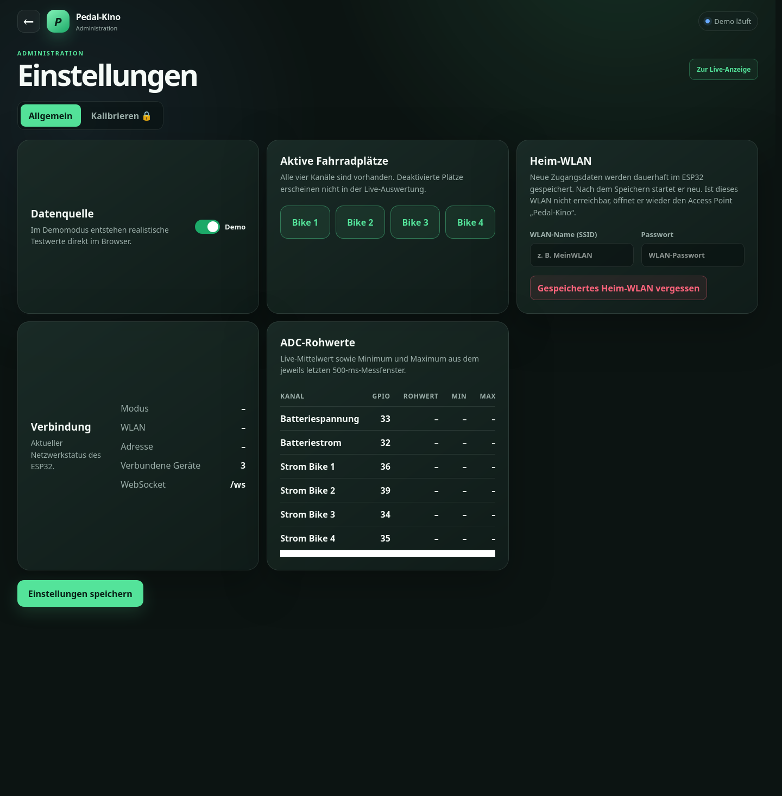
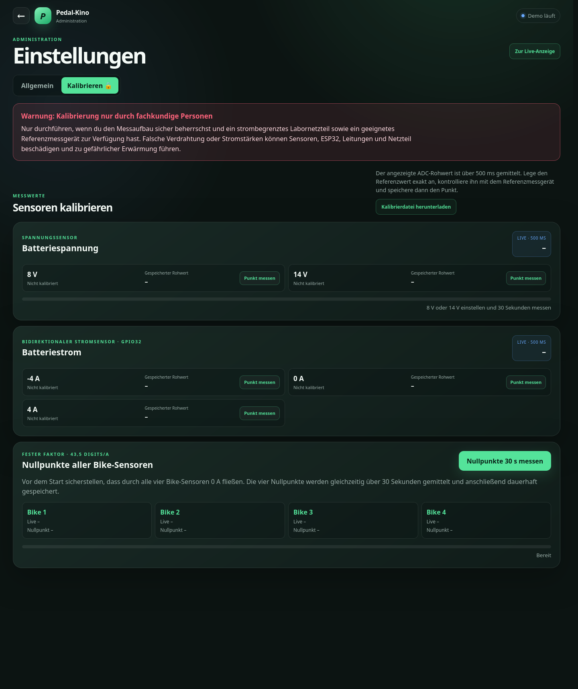

# Pedal-Kino – Benutzerhandbuch

Stand: 18. Oktober 2026

Dieses Handbuch beschreibt die Bedienung der Pedal-Kino-Steuerung mit vier
Fahrradplätzen. Die abgebildeten Werte stammen aus dem Demomodus und sind keine
echten Messwerte.

## 1. Oberfläche öffnen

Der Controller ist im Heimnetz normalerweise unter folgender Adresse erreichbar:

```text
http://192.168.10.31
```

Alternativ kann – sofern die Namensauflösung im Netzwerk funktioniert – diese
Adresse verwendet werden:

```text
http://pedal-kino.local
```

Kann der ESP32 das gespeicherte Heim-WLAN nicht erreichen, öffnet er seinen
eigenen Access Point:

| Einstellung | Wert |
|---|---|
| WLAN-Name | `Pedal-Kino` |
| WLAN-Passwort | `pedalkino` |
| Weboberfläche | `http://192.168.4.1` |

Nach dem Verbinden öffnet das Captive Portal normalerweise automatisch die
Live-Anzeige. Alternativ kann der WLAN- oder Live-QR-Code aus `qr_codes/`
gescannt werden.

Die Oberfläche passt sich an Computer, Tablet und Smartphone an. Über das
Burger-Menü oben links werden Übersicht, einzelne Bikes und Rangliste geöffnet.
Die Administration ist getrennt unter `http://<esp-ip>/config` erreichbar; für
den Access Point lautet die Adresse `http://192.168.4.1/config`.

## 2. Übersicht



Die Übersicht zeigt alle für den laufenden Betrieb wichtigen Werte:

- Das große Instrument links zeigt den Batteriefluss von **500 W Entladen** bis
  **500 W Laden**.
- Rechts daneben stehen Batterieleistung, Busspannung und Batteriestrom.
- „Gerade erzeugt“ ist die Summe der vier aktiven Bikes.
- Jede Bike-Kachel zeigt Fahrer, momentane Leistung, erzeugte Energie und den
  Verlauf der letzten Minute.
- Die Bike-Instrumente reichen von **0 bis 200 W**.

### Vorzeichen und Mindestleistung

Die vier Bike-Stromwerte werden als Absolutwert behandelt. Ein umgekehrt
durchflossener Bike-Sensor führt deshalb nicht zu negativer Leistung.

Eine berechnete Bike-Leistung unter **5 W** wird als null angezeigt und nicht zur
Energie addiert. Dadurch erzeugen Nullpunktdrift und kleines ADC-Rauschen keine
scheinbaren Wattstunden.

Der Batteriestrom bleibt dagegen vorzeichenbehaftet, weil sein Vorzeichen für die
Unterscheidung zwischen Laden und Entladen benötigt wird.

## 3. Bike-Ansicht und Fahrerwechsel



Ein Klick auf eine Bike-Kachel öffnet die Detailansicht. Sie enthält:

- momentane Leistung von 0 bis 200 W,
- den über 500 ms gemittelten Bike-Strom,
- die gemessene Busspannung,
- die seit dem Fahrerwechsel erzeugten Wh,
- den aktuellen Rang und
- den Leistungsverlauf der letzten Minute.

### Fahrer benennen

Über **Name ändern** kann ein Fahrername vergeben, geändert oder durch eine leere
Eingabe entfernt werden. Der Name erscheint:

- auf der Bike-Kachel,
- in der Bike-Detailansicht und
- in der Rangliste.

Fahrernamen liegen nur im Arbeitsspeicher. Sie werden bei einem Neustart des
ESP32 nicht wiederhergestellt.

### Nächster Fahrer

1. Auf der Bike-Kachel oder in der Detailansicht **Nächster Fahrer** wählen.
2. Die Sicherheitsabfrage bestätigen.
3. Der bisherige Fahrer wird mit seinen erzeugten Wh in die Rangliste übernommen.
4. Das Bike erhält die nächste Fahrernummer und beginnt für den neuen Fahrer bei
   0 Wh.

Die anderen Bikes werden dadurch nicht verändert.

## 4. Rangliste



Die Rangliste sortiert aktive und abgeschlossene Fahrer nach erzeugten Wh. Aktive
Einträge tragen den Hinweis **Fährt gerade**, abgeschlossene Einträge den Hinweis
**Abgeschlossen**. Namen können auch direkt in der Rangliste geändert werden.

### Gesamte Veranstaltung zurücksetzen

**Rangliste zurücksetzen** löscht nach einer zusätzlichen „Wirklich?“-Abfrage:

- alle abgeschlossenen Ranglisteneinträge,
- alle Fahrernamen,
- alle aktuellen Wh,
- alle Verlaufskurven und
- die fortlaufende Fahrerzählung.

Danach heißen die aktiven Fahrer wieder Fahrer 1 bis 4; der nächste Fahrer erhält
die Nummer 5. Dieser Reset ist für den Beginn einer neuen Veranstaltung gedacht
und lässt sich nicht rückgängig machen.

## 5. Einstellungen und Diagnose



Die Einstellungen werden direkt über `/config` oder mit dem Admin-QR-Code
geöffnet. Sie sind nicht Teil des Menüs der öffentlichen Live-Anzeige.

### Aktive Fahrradplätze

Nicht verwendete Bikes können deaktiviert werden. Ein deaktivierter Platz liefert
keine Leistung für die Auswertung.

### Heim-WLAN

Hier werden SSID und Passwort des Heim-WLANs eingetragen. Nach dem Speichern
startet der ESP32 neu. Kann er das WLAN innerhalb der vorgesehenen Zeit nicht
erreichen, öffnet er wieder den Access Point `Pedal-Kino`.

Mit **Gespeichertes Heim-WLAN vergessen** werden SSID und Passwort nach einer
Bestätigung dauerhaft gelöscht. Anschließend startet der ESP32 neu und bleibt im
Access-Point-Modus.

### Verbindung

Der Infobereich zeigt Betriebsart, verbundenes WLAN, IP-Adresse beziehungsweise
Hostname und die Anzahl der aktuell verbundenen WebSocket-Geräte.

### ADC-Rohwerte

Die Diagnosetabelle zeigt für jeden Messkanal:

- den Mittelwert des letzten 500-ms-Fensters,
- den kleinsten Rohwert innerhalb dieses Fensters,
- den größten Rohwert innerhalb dieses Fensters und
- den Gültigkeitsstatus.

| Messgröße | GPIO |
|---|---:|
| Batteriespannung | 33 |
| Batteriestrom, bidirektional | 32 |
| Bike-Strom 1 | 36 |
| Bike-Strom 2 | 39 |
| Bike-Strom 3 | 34 |
| Bike-Strom 4 | 35 |

## 6. Kalibrierung



> **Warnung:** Die Kalibrierung darf nur von einer fachkundigen Person mit
> strombegrenztem Labornetzteil und geeignetem Referenzmessgerät durchgeführt
> werden. Akku und Generatoren müssen für den jeweiligen Messaufbau sicher
> getrennt sein. Falsche Polarität, Kurzschlüsse oder zu hohe Ströme können
> Sensoren, Leitungen, ESP32 und Netzteil beschädigen und zu gefährlicher
> Erwärmung führen.

Der Kalibrierbereich ist mit dem Passwort `pedalkino` geschützt. Das Passwort
verhindert versehentliche Bedienung, ersetzt aber keine elektrische
Schutzmaßnahme.

### Allgemeine Regeln

1. Verdrahtung bei ausgeschaltetem Labornetzteil herstellen.
2. Polarität und Strompfad kontrollieren.
3. Strombegrenzung zunächst möglichst klein einstellen.
4. Den Sollwert immer mit einem Referenzmessgerät prüfen. Die Anzeige des
   Labornetzteils allein ist kein ausreichend genauer Referenzwert.
5. Während einer 30-Sekunden-Messung Spannung oder Strom nicht verändern.
6. Erst nach Abschluss der Messung den nächsten Punkt einstellen.

### Batteriespannung an GPIO33

Für die Spannung werden zwei Punkte verwendet:

1. Genau **8 V** anlegen und mit dem Multimeter kontrollieren.
2. Bei 8 V **Punkt messen** wählen und 30 Sekunden unverändert warten.
3. Genau **14 V** anlegen und mit dem Multimeter kontrollieren.
4. Bei 14 V **Punkt messen** wählen und wieder 30 Sekunden warten.

Jeder gespeicherte Rohwert ist der Mittelwert aus ungefähr 60 aufeinanderfolgenden
500-ms-Messfenstern. Der Fortschrittsbalken zeigt Restzeit und Anzahl der Fenster.

### Nullpunkte der vier Bike-Sensoren

Für alle Bike-Sensoren gilt ein fester Faktor von **43,5 ADC-Digits/A**. Im
normalen Betrieb wird deshalb nur der Nullpunkt neu bestimmt:

1. Sicherstellen, dass durch **keinen** der vier Bike-Sensoren Strom fließt.
2. **Nullpunkte 30 s messen** wählen.
3. Bis zum vollständigen Abschluss warten.

Alle vier Nullpunkte werden gleichzeitig über 30 Sekunden gemittelt und danach im
ESP32 gespeichert. Währenddessen dürfen keine Bikes bewegt oder belastet werden.

### Bidirektionaler Batteriestrom an GPIO32

Der Batteriesensor muss Laden und Entladen unterscheiden. Dafür sind die Punkte
**−4 A**, **0 A** und **+4 A** vorgesehen. Die elektrische Richtung muss zur
Beschriftung passen; hier darf kein Absolutwert gebildet werden.

Jeder Punkt verwendet den über 500 ms gemittelten ADC-Rohwert. Vor dem Speichern
muss der Strom stabil sein und mit einem geeigneten Amperemeter kontrolliert
werden.

### Kalibrierdatei sichern

Über **Kalibrierdatei herunterladen** kann der aktuelle Stand als
`pedal-kino-calibration.json` gesichert werden. Eine Sicherung sollte nach jeder
erfolgreichen Kalibrierung abgelegt und mit Datum sowie Hardwarestand beschriftet
werden.

## 7. Statusanzeigen am Gerät

| LED | GPIO | Bedeutung |
|---|---:|---|
| Bereit | 18 | Controller und Messung sind betriebsbereit |
| Fehler | 19 | Start-, Mess- oder OTA-Fehler erkannt |

Beide LEDs sind gemäß Schaltplan aktiv-low angeschlossen.

## 8. Fehlerbehebung

### Oberfläche ist nicht erreichbar

1. Prüfen, ob der ESP32 versorgt wird.
2. `http://192.168.10.31` und `http://pedal-kino.local` testen.
3. In der WLAN-Liste nach `Pedal-Kino` suchen.
4. Mit `pedalkino` verbinden und `http://192.168.4.1` öffnen.

### Alte Oberfläche wird angezeigt

Die Seite vollständig neu laden. Auf Mobilgeräten hilft gegebenenfalls das
Schließen und erneute Öffnen des Browser-Tabs.

### Kleine Werte springen um null

Die ADC-Werte werden bereits über 500 ms gemittelt. Zusätzlich werden Leistungen
unter 5 W weder angezeigt noch gezählt. Bleiben größere Abweichungen ohne Last
bestehen, die 30-Sekunden-Nullpunktmessung der Bike-Sensoren erneut durchführen.

### Laden und Entladen sind vertauscht

Nur beim Batteriestromsensor ist die Richtung relevant. Strompfad und Einbaurichtung
kontrollieren und anschließend −4 A, 0 A und +4 A neu kalibrieren. Die Bike-Sensoren
verwenden dagegen absichtlich den Betrag des Stroms.

## 9. Wartung und OTA

Firmware und Weboberfläche können per OTA aktualisiert werden. Während eines
Uploads darf die Versorgung des ESP32 nicht getrennt werden. Nach einem Update
bleiben die im NVS gespeicherten Sensor-Kalibrierwerte erhalten; Fahrernamen und
die laufende Veranstaltung sind dagegen flüchtige Betriebsdaten.

